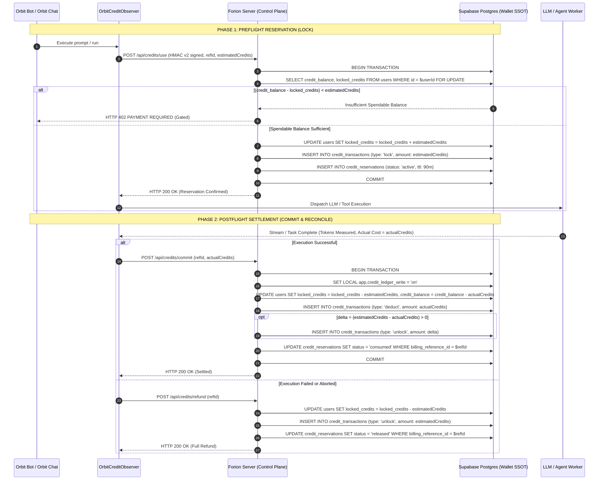
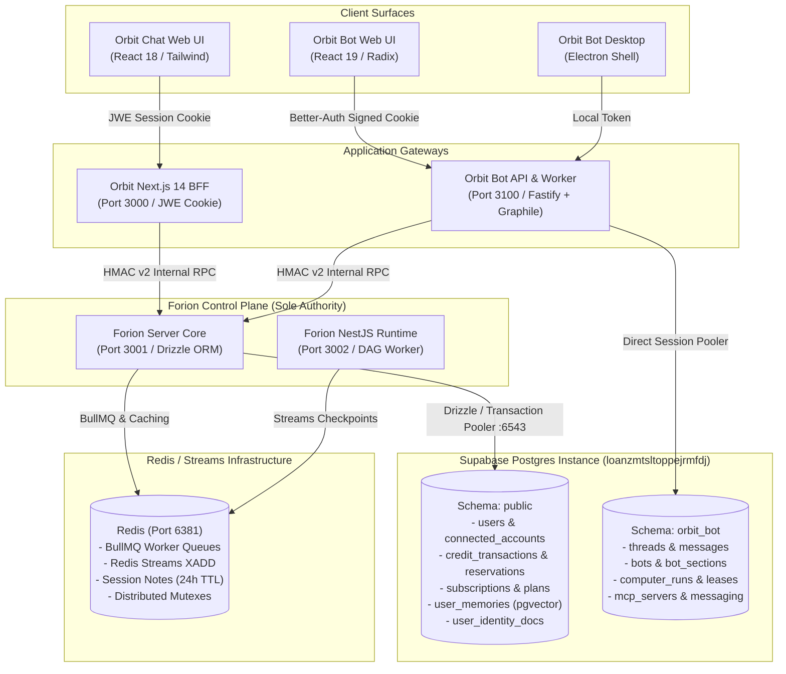

# Unified System Architecture & Master Design
## Orion Platform: Orbit Chat & Orbit Bot (Orion)

**Author:** Systems Architect (`@architect`)  
**Status:** Approved for Verification  
**Target Audience:** `@verifier`, `@coordinator`, Engineering Leadership  
**Date:** November 2026  

---

## Executive Summary

Orion operates two flagship products:
1. **Orbit Chat (Orbit Studio):** A web-based AI full-stack development studio (Next.js 14 App Router BFF, E2B cloud sandboxes, Git/GitHub integration, code generation).
2. **Orbit Bot (Orion):** An autonomous multi-agent task and computer-use automation harness (Fastify/ORPC backend, React 19 web SPA, Electron desktop, Graphile Worker daemon, multi-channel messaging).

Both products have historically evolved separate database conventions, auth setups, and credit models. This architectural specification resolves the unified design across **Auth, Shared Billing/Credits, and Cross-Product Memory**, providing concrete trade-off analysis, definitive technical recommendations, mathematical race-condition prevention, and an actionable migration plan.

---

## 1. The Database Debate: One User Database vs. Two User Databases

### 1.1 Comparative Analysis Matrix

| Evaluation Dimension | Option A: Dual Databases with Sync/Ledger Layer | Option B: Central Single Source of Truth (SSOT) |
| :--- | :--- | :--- |
| **Data Consistency & Race Conditions** | **High Failure Risk.** Asynchronous event sync (webhooks, Redis streams, Kafka) introduces 200ms–5000ms replication lag. Simultaneous usage creates window for concurrent overdrafts. | **Guaranteed ACID Consistency.** Central Postgres database uses atomic row locks (`SELECT ... FOR UPDATE`) or advisory locks. Zero overdraft window. |
| **Credit Double-Spending** | **Prevalent.** If user has 50 credits, both Orbit Chat and Orbit Bot can concurrently lock 40 credits each before sync arrives. Requires distributed locks (Redlock) or complex compensating sagas. | **Mathematically Impossible.** Single row in `users` (`credit_balance`, `locked_credits`) acts as immediate mutex. |
| **Auth & Identity Synchronization** | **Fragile.** User registered on Orbit Chat must be replicated to Orbit Bot. If user logs into Bot immediately after Chat signup, local lookup fails ("User not found") or creates a split account. | **Seamless.** Single canonical `users` record. Orbit Chat issues JWE / session tokens; Orbit Bot uses SSO or validates JWT/HMAC against the central identity core. |
| **Latency Profile** | Local reads are fast, but cross-product balance reservations require distributed 2-Phase Commit (2PC) or multi-hop RPCs (>150ms). | Local network / direct Supabase transaction pooler queries: **< 15ms** latency via internal VPC or Supabase PgBouncer pooler (`:6543`). |
| **Failure Modes & Resilience** | Partial failure modes: Webhook drop, queue dead-lettering, out-of-order ledger commits, split-brain on partition. High operational triage cost. | Fail-closed ACID: Either reservation transaction commits or aborts. Postgres connection retries handled cleanly with exponential backoff. |
| **Maintenance & Operational Overhead** | **Extreme.** Dual schema migrations (Drizzle in Forion vs. Prisma in Orbit Bot), dual billing providers, dual ledger reconcilers, cross-database data repair tools. | **Minimal.** Single billing provider (Dodo Payments / Stripe), single immutable ledger (`credit_transactions`), single reconciliation cron (`CreditsReconcileJob`). |

### 1.2 Definitive Recommendation: Central Single Source of Truth (SSOT)

**Verdict:** **Option B (Central Single Source of Truth in Postgres / Supabase).**

- **Identity, Wallet & Billing Core:** Centrally owned by the **Forion Control Plane** (`forion-server`) backed by Supabase PostgreSQL Tokyo (`loanzmtsltoppejrmfdj`).
- **Product Operational Autonomy:** 
  - Orbit Chat continues to use its App Router BFF proxying to Forion Core.
  - Orbit Bot maintains its application models (120+ Prisma tables for `threads`, `messages`, `bots`, `tasks`, `computer_runs`, `mcp_servers`) in its dedicated schema `orbit_bot` within the same Supabase Postgres instance or isolated database.
  - Orbit Bot **delegates 100% of user identity, credit reservations, commits, refunds, and global memory** to the Central Forion Control Plane via HMAC v2 authenticated internal APIs (`OrbitControlPlaneClient`).

```
+----------------------------------------------------------------------------------------------------+
|                                    CENTRAL ORION IDENTITY & LEDGER                                 |
|                                    (Supabase Postgres: `public` schema)                            |
|                                                                                                    |
|   +-----------------------+     +-------------------------------+     +------------------------+   |
|   |         users         |     |      credit_transactions      |     |  credit_reservations   |   |
|   |-----------------------|     |-------------------------------|     |------------------------|   |
|   | id (text, PK)         |     | id (uuid, PK)                 |     | id (uuid, PK)          |   |
|   | credit_balance (int)  |     | user_id (FK -> users.id)      |     | user_id (FK)           |   |
|   | locked_credits (int)  |     | type (add/deduct/lock/unlock) |     | billing_reference_id   |   |
|   | grace_balance (int)   |     | amount (int)                  |     | amount (int)           |   |
|   | execution_tier (enum) |     | idempotency_key (varchar)     |     | status (active/exp...) |   |
|   +-----------------------+     +-------------------------------+     +------------------------+   |
+----------------------------------------------------------------------------------------------------+
                                      ^                               ^
                       Direct DB / BFF|                               | HMAC-SHA256 v2 RPC
                                      |                               |
                 +--------------------------+           +--------------------------+
                 |        ORBIT CHAT        |           |        ORBIT BOT         |
                 |     (Next.js 14 App)     |           |     (Fastify / ORPC)     |
                 |                          |           |                          |
                 | - E2B Dev Studio         |           | - Multi-agent Bot Engine |
                 | - JWE Cookie Auth        |           | - Better-Auth (SSO/Local)|
                 | - Project Code Gen       |           | - Schema: `orbit_bot`    |
                 +--------------------------+           +--------------------------+
```

---

## 2. Shared Credits Architecture & Two-Phase Smart Locking

### 2.1 The Cross-Product Instant Usability Flow

When a user purchases an Orbit subscription or top-up credit pack in Orbit Chat:
1. **Purchase in Orbit Chat:** User initiates checkout -> Orbit calls Forion `/api/internal/orbit/payments/checkout-session` -> redirects to Dodo Payments.
2. **Webhook Ingestion:** Dodo fires `payment.succeeded` or `subscription.created` to `forion-server` (`POST /payments/webhook/dodo`).
3. **Atomic Balance Update (Within Single Transaction):**
   ```sql
   BEGIN;
   -- 1. Idempotency Check
   INSERT INTO processed_webhook_events (webhook_id, event_type) VALUES ($webhookId, $type);
   -- 2. Unlock trigger permission
   SET LOCAL app.credit_ledger_write = 'on';
   -- 3. Record transaction in immutable ledger
   INSERT INTO credit_transactions (user_id, type, amount, reference_id, product)
   VALUES ($userId, 'add', $creditsAdded, $paymentId, 'orbit-chat');
   -- 4. Increment live wallet balance & upgrade tier
   UPDATE users 
   SET credit_balance = credit_balance + $creditsAdded,
       execution_tier = 'paid',
       updated_at = NOW()
   WHERE id = $userId;
   COMMIT;
   ```
4. **Immediate Visibility in Orbit Bot:**
   - Next time Orbit Bot's UI `OrbitCreditBadge` queries `/api/orbit/billing`, it calls Forion `GET /api/credits/balance/:userId`.
   - **Replication Lag:** **0.00ms** (both read from the same authoritative table).
   - Real-time push: Forion publishes `wallet:updated:{userId}` to Redis. Orbit Bot's WebSocket / SSE hub pushes instantaneous balance update to the browser badge without waiting for polling.

### 2.2 Atomic Two-Phase Lock & Settlement Lifecycle

To prevent concurrent overdrafts across both products (e.g. user with 5 credits launching an Orbit Chat code run and an Orbit Bot computer automation simultaneously):



### 2.3 Automated Sweeper & Failure Guardrails
- **`StaleLockJob` (Every 5 minutes):** Scans `credit_reservations` where `status = 'active'` and `expires_at < NOW()`. Automatically restores `locked_credits` to the user and marks reservation `expired`. Prevents crashed workers from permanently stranding credits.
- **`CreditsReconcileJob` (Daily):** Computes `SUM(amount)` from `credit_transactions` and verifies against `users.credit_balance`. Any discrepancy triggers automated audit alert.

---

## 3. Memory vs. History Sharing: What CAN and CANNOT Be Done

### 3.1 Strict Separation: Chat History (What CANNOT Be Shared)

Chat history **must remain completely isolated** between Orbit Chat and Orbit Bot:

1. **Incompatible Dialogue Models & Schemas:**
   - Orbit Chat operates on Studio project conversations (`conversations`, `messages`), storing structured code diffs, AST file patches, E2B terminal outputs, and specialized turn stages (`opening`, `clarification`, `final_summary`).
   - Orbit Bot operates on threaded execution events (`Thread`, `Message`, `Event`), capturing multi-agent tool execution loops (`agent.tool.called`, `agent.tool.completed`), browser DOM actions, and multi-channel webhook contexts (Slack, Telegram).
2. **Context Window Degradation:**
   - Concatenating raw chat logs across products pollutes the LLM context window with hundreds of irrelevant code diffs or webhook payloads, degrading model reasoning and multiplying token costs by 5x–10x.
3. **Security & Data Governance Boundary:**
   - Orbit Bot processes organizational background routines and SCIM directory operations. Orbit Chat is an interactive user IDE. Blurring raw transcripts creates high privilege escalation and privacy leak risks.

### 3.2 Cross-Product Semantic Memory: What CAN Be Shared

While raw transcripts remain isolated, distilled **User Knowledge, Preferences, and Working Context** must seamlessly bridge both products.

```
+----------------------------------------------------------------------------------------------------+
|                                CENTRAL SEMANTIC MEMORY SYSTEM (Forion)                             |
+----------------------------------------------------------------------------------------------------+
|  1. USER IDENTITY DOC (`user_identity_docs`)                                                      |
|     - Single consolidated Markdown document per user across ALL products.                          |
|     - Captures: Coding styles, preferred tech stacks, timezone, communication tone, active goals.   |
|     - Editable in Orbit Chat "About Me" dock; loaded into Orbit Bot as `<user_profile>`.           |
+----------------------------------------------------------------------------------------------------+
|  2. SEMANTIC VECTOR STORE (`user_memories` with pgvector)                                          |
|     - 1536-dimensional embeddings (Requesty / OpenAI text-embedding-3-small).                      |
|     - Tagged with `source_type`: 'orbit-chat' vs. 'orbit-bot'.                                      |
|     - Categories: `preference`, `knowledge`, `context`, `behavior`, `goal`, `correction`.          |
|     - Hybrid Retrieval: Cosine similarity search (`<=>`) filtered by active user & importance.     |
+----------------------------------------------------------------------------------------------------+
|  3. TIME-BUCKETED ACTIVITY ARCHIVES (`user_memory_archives`)                                       |
|     - Day / Week / Month progressive rollups of what the user achieved across products.             |
|     - Keeps Orbit Chat aware of tasks Orbit Bot completed today without parsing raw message logs.  |
+----------------------------------------------------------------------------------------------------+
```

### 3.3 Bidirectional Memory Retrieval & Formation Flow

1. **Orbit Bot Forming Memory:**
   - Orbit Bot agent discovers: *"User's production Next.js frontend is deployed at https://app.acme.com on Vercel."*
   - Orbit Bot executes tool call `remember()` -> invokes Forion internal endpoint:
     `POST /memory/internal/store` with payload:
     `{ userId, content: "Production Next.js frontend is deployed at https://app.acme.com", category: "knowledge", sourceType: "orbit-bot", importance: 0.85 }`.
   - Forion computes embedding via Requesty (`text-embedding-3-small`) and inserts into `user_memories`.

2. **Orbit Chat Referencing Memory:**
   - In Orbit Chat, user asks: *"Where is my live frontend hosted and how do I test it?"*
   - Orbit Chat BFF calls Forion `POST /memory/search-internal` with `{ userId, query: "live frontend hosting URL", topK: 3 }`.
   - Forion performs pgvector cosine search:
     ```sql
     SELECT id, content, category, source_type, 1 - (embedding <=> $queryVec) AS similarity
     FROM user_memories
     WHERE user_id = $userId AND is_deleted = false
     ORDER BY embedding <=> $queryVec
     LIMIT 3;
     ```
   - Injected into Orbit Chat prompt:
     ```markdown
     <cross_product_memory>
     - [Orbit Bot Knowledge]: Production Next.js frontend is deployed at https://app.acme.com on Vercel.
     </cross_product_memory>
     ```
   - Orbit Chat answers accurately with zero user repetition!

---

## 4. Architectural Blueprint & Security Perimeter

### 4.1 Internal Service Authentication: HMAC-SHA256 v2

All inter-service traffic between Orbit Chat / Orbit Bot and Forion Control Plane is authenticated using cryptographic HMAC-SHA256 v2 request signing:

```
Payload Format:
v2|HTTP_METHOD|USER_ID|REQUEST_PATH_WITH_QUERY|UNIX_TIMESTAMP

Headers Passed:
Authorization:        Bearer <FORION_ORBIT_INTERNAL_SECRET>
X-Orbit-Sig-Version:  2
X-Orbit-User-Id:      <userId>
X-Orbit-Req-Ts:       <timestamp_seconds>
X-Orbit-Req-Sig:      Base64(HMAC-SHA256(secret, payload))
X-Orbit-Client:       "orbit-bff" | "orbit-bot"
```

**Guardrail:** Forion's `OrbitIdentityGuard` validates:
1. Timestamp skew $\le 300\text{ s}$ (prevents replay attacks).
2. Constant-time comparison of `X-Orbit-Req-Sig` against computed HMAC.
3. Sanitizes and overrides any client-supplied `x-user-id` header to guarantee non-repudiation.

### 4.2 End-to-End System Topology



---

## 5. Migration Path & Zero-Downtime Cutover

### Phase 1: Identity & Schema Harmonization (Weeks 1–2)
1. **Schema Namespace Isolation:** Verify Orbit Bot tables are strictly isolated to schema `orbit_bot` in Supabase Postgres, with `search_path = orbit_bot, public`.
2. **Canonical User ID Resolution (Eliminating HTTP 409 Conflicts):** `public.users` enforces `UNIQUE(provider, external_id)`. When an existing Orbit Chat user signs into Orbit Bot via Google/GitHub OAuth, Orbit Bot must lookup/adopt the canonical Forion `userId` rather than generating an orphaned Better-Auth ID, avoiding unique key collisions during `sync-user`.
3. **Purge Decommissioned Supabase DSNs:** The legacy Supabase project ref `dijvomjbqdrzjapgcrof` is defunct (`ENOTFOUND`). Purge all references from `orbit/.env`, `forion-server/.env`, and production secrets, standardizing exclusively on the live instance `loanzmtsltoppejrmfdj`.
4. **Database Trigger Compatibility:** Retain `users_credit_ledger_guard` trigger in `public.users`. Ensure any service modifying credit balance executes `SET LOCAL app.credit_ledger_write = 'on'`.

### Phase 2: Shared Credits Cutover (Weeks 3–4)
1. **Enable Managed Mode in Orbit Bot:** Set `ORBIT_BILLING_ENABLED=true` in `orbit-bot/.env`.
2. **Activate Two-Phase Lock with 5-Minute TTL:** Route all Orbit Bot inference requests through `OrbitCreditObserver`, making preflight `POST /api/credits/use` and postflight `POST /api/credits/commit` calls to Forion. Set bot reservation lock TTL to **5 minutes** (down from 90 minutes) to prevent stranded credits if an autonomous bot process or sandbox terminates unexpectedly.
3. **Deprecate Local Stripe in Orbit Bot:** Disable local checkout routes in Orbit Bot; redirect users to unified Orbit subscription checkout powered by Dodo Payments on Forion.
4. **Run Ledger Reconciliation:** Execute `test-orbit-billing.mjs` against staging to verify zero discrepancies between reservation locks, deductions, and wallet balances.

### Phase 3: Cross-Product Semantic Memory Bridge (Weeks 5–6)
1. **Memory Storage Adapter:** Deploy `ForionMemoryStore` in Orbit Bot (`packages/memory`), replacing purely local `MEMORY.md` markdown files with upstream persistence to `public.user_memories`.
2. **Hybrid Context Injection:** Update Orbit Bot prompt composer to query `POST /memory/search-internal` and inject top-3 memories into `<user_persistent_memory>`.
3. **Identity Doc Dock Integration:** Expose Forion's `GET /api/user-doc` in Orbit Bot's settings UI, allowing users to view and edit their unified profile from either product.

---

## 6. End-to-End Integration Checklist for `@verifier`

The Integration Verifier (`@verifier`) must execute and validate the following test matrix:

- [ ] **Test 1: HMAC-SHA256 v2 Signature Verification**
  - Verify that requests generated with `signForionRequest` (Orbit Chat) and `sign` (Orbit Bot) match Forion's `OrbitIdentityGuard`.
  - Inject 350-second timestamp skew -> Confirm HTTP 401 Replay Attack rejection.
  - Mutate request body or URL path -> Confirm HTTP 401 Invalid Signature rejection.
- [ ] **Test 2: Two-Phase Locking & Atomic Reservation**
  - Initialize test user with 10 credits.
  - Dispatch concurrent inference request from Orbit Chat (requires 8 credits) and Orbit Bot (requires 8 credits) simultaneously (< 10ms gap).
  - Verify: Exactly ONE request succeeds (locks 8 credits); the other receives HTTP 402 `INSUFFICIENT_CREDITS`.
  - Confirm `locked_credits` = 8, `credit_balance` = 10, spendable balance = 2.
- [ ] **Test 3: Settlement, Delta Unlock & Refunds**
  - Lock 8 credits -> Settle with actual cost = 5 credits.
  - Verify `credit_balance` decrements by 5, `locked_credits` resets to 0, and `unlock` ledger row records delta of 3 credits.
  - Dispatch failed run -> Trigger `/api/credits/refund` -> Verify full 8 credits unlocked.
- [ ] **Test 4: Stale Reservation TTL Sweeper**
  - Create active reservation with simulated `expires_at` in the past.
  - Trigger `StaleLockJob` -> Verify reservation transitions to `expired` and `users.locked_credits` decrements accordingly.
- [ ] **Test 5: Cross-Product Memory Ingestion & Semantic Retrieval**
  - Orbit Bot writes memory via `POST /memory/internal/store` (`"User works on Go microservices with Docker"`).
  - Orbit Chat queries `POST /memory/search-internal` with query `"What container runtime does the user use?"`.
  - Verify cosine similarity $\ge 0.75$ and memory returned with `source_type: 'orbit-bot'`.
- [ ] **Test 6: Chat History Isolation Verification**
  - Query Orbit Chat conversations endpoint -> Verify Orbit Bot threads are NOT listed.
  - Query Orbit Bot threads endpoint -> Verify Orbit Chat project messages are NOT listed.
